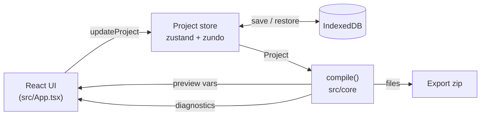

# Brandkit for Claude

A browser app for building a brand design system visually, then exporting it as a Claude Design System package, a brand skill and a shadcn theme. See [`docs/SPEC.md`](docs/SPEC.md).



## Stack

| Area                              | Choice                                                           |
| --------------------------------- | ---------------------------------------------------------------- |
| Runtime, dev server, build, tests | Bun (no Vite)                                                    |
| UI                                | React 19, TypeScript, Tailwind v4, shadcn (new-york)             |
| State                             | zustand, zundo (undo/redo), idb-keyval (IndexedDB)               |
| Validation                        | zod                                                              |
| Design logic                      | culori (colour), fflate (zip), recharts (charts)                 |
| Tests                             | `bun test` + happy-dom + React Testing Library; Playwright + axe |
| Quality                           | oxlint, oxfmt, `bun check`                                       |
| Hosting                           | GitHub Pages (static build)                                      |

## Quick start

```bash
bun install
bun dev                # dev server with hot reload
bun test               # unit and component tests
bun run test:e2e       # builds, then runs Playwright (first time: bunx playwright install chromium)
bun run check          # type check
bun run lint           # oxlint
bun run format         # oxfmt (format:check in CI)
bun run build          # static bundle in dist/
```

## Folder map

| Folder               | What's in it                                                                                                      |
| -------------------- | ----------------------------------------------------------------------------------------------------------------- |
| `src/core/`          | Framework-free design core: Project schema, default project, `compile()`. No React or zustand (enforced by lint). |
| `src/state/`         | The project store: undo/redo and IndexedDB persistence.                                                           |
| `src/components/ui/` | shadcn components.                                                                                                |
| `src/lib/`           | shadcn's `cn()` helper.                                                                                           |
| `styles/`            | Global Tailwind and shadcn theme CSS.                                                                             |
| `test/`              | `bun test` preload (happy-dom, jest-dom matchers).                                                                |
| `e2e/`               | Playwright specs and the static server that mimics GitHub Pages.                                                  |
| `docs/`              | Spec and design research.                                                                                         |
| `.github/workflows/` | CI and Pages deploy.                                                                                              |
