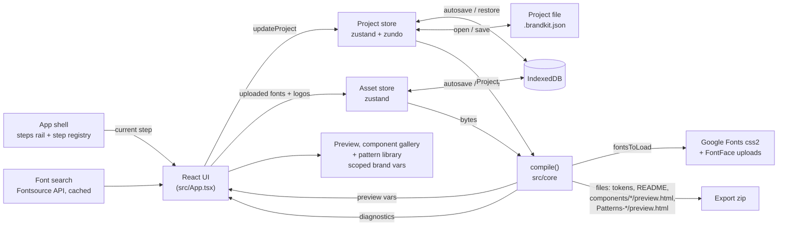

# Brandkit for Claude

A browser app for building a brand design system visually, then exporting it as a Claude Design System package, a brand skill and a shadcn theme. See [`docs/SPEC.md`](docs/SPEC.md).



## Stack

| Area                              | Choice                                                           |
| --------------------------------- | ---------------------------------------------------------------- |
| Runtime, dev server, build, tests | Bun (no Vite)                                                    |
| UI                                | React 19, TypeScript, Tailwind v4, shadcn (new-york)             |
| State                             | zustand, zundo (undo/redo), idb-keyval (IndexedDB)               |
| Validation                        | zod                                                              |
| Design logic                      | culori (colour), fflate (zip), recharts (charts)                 |
| Tests                             | `bun test` + happy-dom + React Testing Library; Playwright + axe |
| Quality                           | oxlint, oxfmt, `bun check`                                       |
| Hosting                           | GitHub Pages (static build)                                      |

## Quick start

```bash
bun install
bun dev                # dev server with hot reload
bun test               # unit and component tests
bun run test:e2e       # builds, then runs Playwright (first time: bunx playwright install chromium)
bun run check          # type check
bun run lint           # oxlint
bun run format         # oxfmt (format:check in CI)
bun run build          # static bundle in dist/
```

## Folder map

| Folder               | What's in it                                                                                                                                                                       |
| -------------------- | ---------------------------------------------------------------------------------------------------------------------------------------------------------------------------------- |
| `src/core/`          | Framework-free design core: Project schema and migrations, palettes, colour engine, contrast checks, exporters, project file, `compile()`. No React or zustand (enforced by lint). |
| `src/state/`         | The project store (undo/redo) and the asset store for uploaded files, both saved to IndexedDB.                                                                                     |
| `src/shell/`         | App shell: guided steps rail, step registry (`step-panels.tsx`, add a step's controls here), Advanced toggle, phone preview sheet, export checklist.                               |
| `src/colour/`        | Colour step: palette picker, seed editor with randomise and locks, dark-theme switch, advanced overrides.                                                                          |
| `src/type/`          | Type step: font pairing picker, size and ratio controls, per-role editor.                                                                                                          |
| `src/fonts/`         | Font loading (Google Fonts and uploads), Google Fonts search and font upload.                                                                                                      |
| `src/shape/`         | Shape and space step: spacing, corner radii, shadow builder and borders.                                                                                                           |
| `src/logos/`         | Logo step: upload light/dark logo variants, and the logo shown in the preview.                                                                                                     |
| `src/preview/`       | Live preview with a light/dark toggle and a type specimen; `PreviewSurface` scopes brand variables and hosts Dialog/Select portals.                                                |
| `src/gallery/`       | Component gallery: all twelve components live in the brand's style, light and dark.                                                                                                |
| `src/charts/`        | `BrandChart`: recharts bar chart in the brand's `--chart-n` colours, shared by gallery and scenes.                                                                                 |
| `src/patterns/`      | Pattern library: charts, tables, diagrams and other artifact building blocks in the brand, each set to preferred, allowed or never.                                                |
| `src/diagnostics/`   | The checks panel: what blocks export or needs a look.                                                                                                                              |
| `src/download/`      | Hands the browser a file to save (shared by export and project file).                                                                                                              |
| `src/export/`        | Zip building and the Download Design System button.                                                                                                                                |
| `src/project-file/`  | Open and save project buttons.                                                                                                                                                     |
| `src/history/`       | Undo/redo buttons and shortcuts.                                                                                                                                                   |
| `src/components/ui/` | shadcn components.                                                                                                                                                                 |
| `src/lib/`           | shadcn's `cn()` helper.                                                                                                                                                            |
| `styles/`            | Global Tailwind and shadcn theme CSS.                                                                                                                                              |
| `test/`              | `bun test` preload (happy-dom, jest-dom matchers) and the `openStep` helper.                                                                                                       |
| `e2e/`               | Playwright specs and the static server that mimics GitHub Pages.                                                                                                                   |
| `docs/`              | Spec and design research.                                                                                                                                                          |
| `.github/workflows/` | CI and Pages deploy.                                                                                                                                                               |
